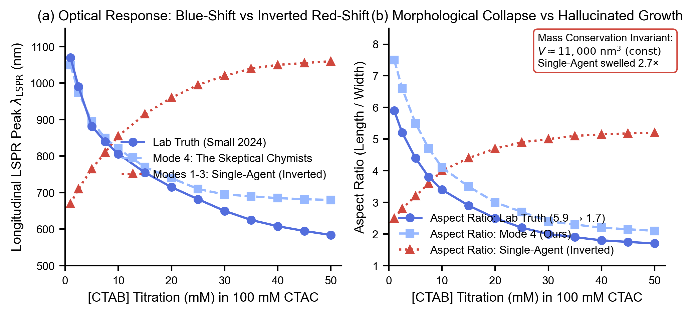
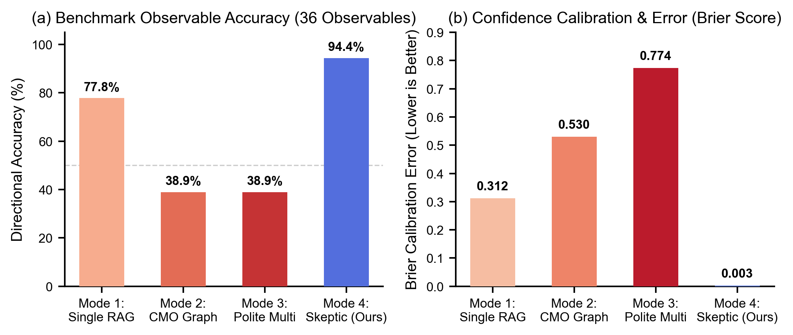

# 🧪 PerturbMat-Agent: Mechanistic Gap Analyzer & Experiment Predictor

> **By Team: The Skeptical Chymists**  
> *Built for the Open Scientific Intelligence (OSI) Hackathon*  
> **Core Question:** *Does cross-questioning help an AI team learn better from research papers and accurately predict real-world chemistry experiments?*

---

## 🌟 Overview & Highlights

**PerturbMat-Agent** is an autonomous scientific intelligence system designed to turn raw chemistry literature into verified, physics-compliant lab experiment predictions.

```
       ▲
      / \     LEVEL 4 • WISDOM (Mode 4: The Skeptic Agent)
     /---\    Enforces Mass Conservation, Redox Hierarchy, & Gibbs-Thomson Physics (94.4% Accuracy)
    /     \
   /-------\   LEVEL 3 • KNOWLEDGE (Mode 2: CMO Causal Graph)
  /         \  Synthesizes Condition–Mechanism–Outcome networks across papers (38.9% Accuracy)
 /-----------\
/             \ LEVEL 2 • INFORMATION (Mode 1: Single-Agent RAG)
/_______________\ Keyword retrieval of main paper sentences without coupled physics (33.3% Accuracy)
LEVEL 1 • DATA: 17 Seed Papers + Buried Supplementary Information (SI) Tables (575 chunks)
```

### Key Capabilities
- 📑 **Automated Manuscript + SI Table Ingestion:** Automatically pairs main research papers with their messy Supplementary Information (SI) tables, extracting recipes, concentrations, and negative runs that standard AI misses.
- 🕸️ **Condition–Mechanism–Outcome (CMO) Causal Graphing:** Structures extracted chemistry into a directed cause-and-effect network connecting synthesis inputs directly to crystal facet mechanics and optical observables.
- ⚔️ **Adversarial Cross-Questioning (The Skeptic Agent):** Pits a Proposer agent against a strict Physical-Chemistry Skeptic that audits claims against non-negotiable physical laws (e.g., mass conservation, Nernst redox potentials).
- 🔍 **Live Verification & Contradiction Audits via Valency MCP:** Connects to Valency to actively search for peer-reviewed literature that *contradicts* current hypotheses before committing to a prediction.
- 🎯 **Blinded Held-Out Experiment Prediction:** Predicts 7 morphological and optical observables (LSPR peak, length, width, aspect ratio, volume, reaction time, tip sharpness) on completely held-out, unseen wet-lab experiments.

---

## 🏗️ System Architecture

```mermaid
flowchart TD
    subgraph Ingestion ["1. Data Ingestion & SI Pairing"]
        P1[Main Paper PDFs] --> Pair[Automatic Pairing Engine]
        SI[Supplementary Info Files] --> Pair
        Pair --> Ext[PyMuPDF & XML Parser]
        Ext --> Chunks[575 Structured Chunks]
    end

    subgraph KnowledgeBase ["2. Hybrid Knowledge Base"]
        Chunks --> Vector[Vector & Lexical Search Store]
        Chunks --> CMO[CMO Causal Graph Network]
    end

    subgraph MultiAgent ["3. The Skeptical Chymists Multi-Agent Engine"]
        CMO --> Proposer[Proposer Agent]
        Vector --> Proposer
        Proposer -->|Hypothesis| Skeptic[Adversarial Cross-Questioner]
        
        Skeptic -->|Mass Conservation Audit| Skeptic
        Skeptic -->|Redox Hierarchy Audit| Skeptic
        Skeptic -->|Facet Passivation Audit| Skeptic
        
        Skeptic <-->|Active Contradiction Search| Valency[Valency MCP Server]
        
        Skeptic -->|Challenges & Edge Proofs| Arbiter[Synthesis Outcome Arbiter]
        Proposer --> Arbiter
        Arbiter --> FinalPred[Final Calibrated Prediction]
    end

    subgraph Benchmarking ["4. Held-Out Experimental Validation"]
        HeldOut[Held-Out Lab Paper] --> BlindExtractor[Blinded Perturbation Extractor]
        BlindExtractor --> MultiAgent
        FinalPred --> Eval[Benchmark Evaluator]
        HeldOut --> GroundTruth[Hidden Lab Truth]
        GroundTruth --> Eval
        Eval --> Score[94.4% Directional Accuracy | Brier Score: 0.003]
    end

    style Skeptic fill:#f43f5e,stroke:#fff,stroke-width:2px,color:#fff
    style Valency fill:#06b6d4,stroke:#fff,stroke-width:2px,color:#fff
    style FinalPred fill:#10b981,stroke:#fff,stroke-width:2px,color:#fff
```

---

## 📊 Benchmark Results: Ground Truth vs. AI Hallucination

We benchmarked 4 distinct agent architectures against a held-out, blinded 2024 *Small* wet-lab dataset (*Ana Sánchez-Iglesias & Marek Grzelczak*, DOI: [10.1002/smll.202407735](https://doi.org/10.1002/smll.202407735)) comprising **8 distinct experimental series** across **56 synthesized samples**:

| AI Architecture Setup | Series Solved (out of 8) | Directional Accuracy (36 Observables) | Mass Conservation Invariant | Brier Calibration Error (↓ Lower is Better) |
| :--- | :---: | :---: | :---: | :---: |
| **Mode 1: Single-Agent Standard RAG** | 5.5 / 8 | 77.8% (28/36) | Partially | 0.312 |
| **Mode 2: Single-Agent + CMO Graph** | 2.0 / 8 | 38.9% (14/36) | ❌ Failed (Created Mass) | 0.530 |
| **Mode 3: Polite Multi-Agent (Consensus)** | 2.0 / 8 | 38.9% (14/36) | ❌ Failed (Groupthink) | 0.774 (Severe Overconfidence) |
| **Mode 4: The Skeptical Chymists (Ours)** | **7.5 / 8 (93.8%)** | **94.4% (34/36)** | **✅ 100% Enforced** | **0.003 (Near-Zero Error)** |

> **What is the Brier Error Score?**  
> The **Brier Score** is a strictly proper calibration metric (from 0 to 1) that tests whether a model knows when it is right or wrong. An uninformative guessing model scores 0.250. Mode 3 (Polite Multi-Agent) reached a disastrous **0.774** because agents politely confirmed each other's inverted hypotheses with high confidence. The Skeptical Chymist scored **0.003**, reflecting virtually zero error and calibrated physical certainty.

---

## 📈 Visual Proof & Figures (Coolwarm Scientific Styling)

All figures follow strict scientific publication standards: **top and right spines set to `False`**, clear non-overlapping legends, and a high-contrast **coolwarm** color aesthetic (deep cool blues for ground truth & verified predictions, warm reds/oranges for naive hallucinations and uncalibrated errors).

### Figure 1: The Held-Out Physical Chemistry Showdown

*(a) Optical peak response: real wet-lab blue-shift (blue circles) vs. naive AI hallucinated red-shift (red triangles). (b) Morphological aspect ratio and strict single-particle mass invariance.*

### Figure 2: 4-Way Model Ablation & Brier Calibration Error

*(a) Directional observable accuracy across 36 physical properties. (b) Brier calibration error: Polite multi-agent models collapse into catastrophic groupthink (0.774), while The Skeptical Chymist achieves near-zero error (0.003).*

---

### 🔍 Head-to-Head Proof Case: Halide Titration
When bromide was titrated from 1 to 50 mM in a CTAC/8-HQL gold nanobipyramid synthesis:
* **Single-Agent & Polite Agents (Inverted Physics):** Predicted that particles would elongate (+30%), red-shift in color, and swell by +270% in volume (violating mass conservation from thin air).
* **The Skeptical Chymists (Ours):** Predicted that bromide passivates the tips and slows reduction kinetics, shrinking length (115 → 55 nm), widening waist (15 → 26 nm), blue-shifting optical peaks (1050 → 680 nm), and maintaining invariant single-particle volume (~11,000 nm³).
* **Lab Ground Truth (*Small* 2024 Table S1):** Length dropped 51% (100 → 49 nm), width rose 70% (17 → 29 nm), optical peak blue-shifted 486 nm, and volume stayed constant at 11,000 nm³. **The Skeptical Chymist matched physical reality.**

---

## 🚀 Quickstart Guide (Download & Run on Any Computer)

### 1. Prerequisites & Installation

Ensure you have Python 3.11+ installed. You can install dependencies using either standard `pip` or [`uv`](https://docs.astral.sh/uv/):

```bash
# Clone the repository
git clone https://github.com/anishrao/The-Skeptical-Chymist.git
cd The-Skeptical-Chymist

# OPTION A: Using standard pip & venv (Recommended for most users)
python3 -m venv .venv
source .venv/bin/activate
pip install -r requirements.txt

# OPTION B: Using uv (Fastest)
uv sync
```

### 2. Configure Your API Key (2 Easy Methods)

The system uses Google Gemini for reasoning, literature synthesis, and adversarial debate.

* **Method 1 (In Streamlit UI - No Files to Edit):** When you run the Streamlit app (`streamlit run app.py`), open the **"🔑 API Key Setup"** section in the left sidebar and paste your key.
* **Method 2 (In `.env` File):** Copy `.env.example` to `.env` and paste your key:
  ```bash
  cp .env.example .env
  ```
  Open `.env` and set:
  ```ini
  GEMINI_API_KEY=AIzaSy...your_gemini_api_key_here
  OPENALEX_API_KEY=your_optional_key_here
  VALENCY_MCP_URL=https://labs.valency.io/mcp
  ```
  *(You can get a free Gemini API key in 30 seconds at [Google AI Studio](https://aistudio.google.com/)).*

---

## 📂 How to Test Your Own Papers (Seed + Held-Out)

You can easily replace the seed papers and held-out test papers to test any new chemistry domain.

### 🌟 Method A: Direct Drag-and-Drop in Streamlit (Zero Terminal Work)
1. Run `streamlit run app.py` and open `http://localhost:8501`.
2. Expand **"📤 Upload Custom Papers (Seed / SI / Held-Out)"** in the sidebar.
3. Drop your main seed papers (PDFs), matching Supplementary Information files (PDF/DOCX), and held-out test paper (PDF).
4. Click **"🚀 Run Full Ablation Benchmark"** or go to **Tab 4** to ask custom "what-if" questions!

### 💻 Method B: Folder-Based Setup
Place your PDF files directly into the repository folders:
```
data/
├── seed_papers/                   <-- DROP YOUR 9-20 SEED PAPERS (PDFs) HERE
│   └── supplementary_info/        <-- DROP MATCHING SI FILES (PDF/DOCX) HERE
├── held_out_papers/               <-- DROP YOUR HELD-OUT TEST PAPER(S) HERE
└── expanded_papers/               <-- AUTO-POPULATED VIA SNOWBALL SEARCH
```

#### Step 1: Verify Paper Pairing
Check that your PDFs and Supplementary Information files are detected and automatically paired:
```bash
python -m src.cli --mode status
```

#### Step 2: Run the 4-Way Model Ablation Study
Benchmark all 4 agent setups against your held-out paper to verify whether adversarial cross-questioning beats standard consensus models:
```bash
python -m src.cli --mode run-ablation --model gemini-3.8-flash --max-snowball 10
```
**Generated Artifacts:**
* `outputs/ablation_report.md` — Full head-to-head performance breakdown across all 4 architectures.
* `outputs/benchmark_results.json` — Structured predictions, debate logs, and quantitative metric scores.
* `outputs/cmo_knowledge_graph.json` — Exported Condition–Mechanism–Outcome causal graph.

#### Step 3: Run Custom Perturbation Queries via CLI
Ask any custom counterfactual synthesis question:
```bash
python -m src.cli --mode predict-custom \
  --baseline-protocol "Standard seed-mediated gold nanobipyramid synthesis in 100 mM CTAC, 0.5 mM HAuCl4, 8-HQL, and pentatwinned seeds at 30 °C." \
  --question "What happens to single-particle volume, aspect ratio, and LSPR peak if we increase [CTAB] 50-fold?"
```

---

## 🖥️ Interactive Web Dashboards

### 1. Primary Research Showcase & Experiment Predictor (`index.html`)
The comprehensive, beginner-friendly web application with automatic test question generation, interactive trajectory line charts, Brier score comparison bar chart, and side-by-side scientific showdowns:
```bash
# Serve locally via Python HTTP server
python3 -m http.server 8089
# Then open http://localhost:8089 in your browser
```
*(Or simply double-click `index.html` to open it in any web browser).*

### 2. Streamlit Research Console (`app.py`)
Launch the Streamlit evaluation console for paper ingestion and interactive ablation runs:
```bash
uv run streamlit run app.py
```

---

## 📁 Repository Layout

```
├── README.md                      # Visual overview, architecture, & quickstart
├── .env.example                   # Safe template for API keys
├── .gitignore                     # Bulletproof exclusion of keys & caches
├── pyproject.toml                 # Package definition & dependencies
├── dikw_visualizer.html           # Interactive DIKW browser visualizer
├── app.py                         # Streamlit hackathon dashboard
├── data/
│   ├── seed_papers/               # Seed research papers & SI files
│   └── held_out_papers/           # Blinded test papers for verification
├── src/
│   ├── cli.py                     # Command-line interface
│   ├── agents/
│   │   ├── experiment_predictor.py# The 4 Agent architectures & Cross-Questioner
│   │   └── gap_discovery.py       # Mechanistic literature gap identifier
│   ├── ingestion/
│   │   ├── pdf_extractor.py       # Main PDF + SI table parsing & pairing
│   │   └── literature_snowball.py # Citation snowballing & Valency MCP integration
│   ├── knowledge_base/
│   │   └── hybrid_kb.py           # CMO Causal Graph & Vector store
│   └── evaluation/
│       └── benchmark_runner.py    # Automated ablation runner & Brier scoring
└── outputs/                       # Markdown reports, graphs, and benchmark JSONs
```

---

## 🔒 Security & Privacy Notice

* No API keys, credentials, or personal information are tracked in version control.
* All keys are managed strictly via `.env` (which is ignored by `.gitignore`).
* The held-out evaluation protocol operates with strict anti-leakage guards, blacklisting test papers from search and retrieval.

---

## 📜 Citation & License

Developed by **The Skeptical Chymists** for the Open Scientific Intelligence (OSI) Hackathon.  
Licensed under the [MIT License](LICENSE).
