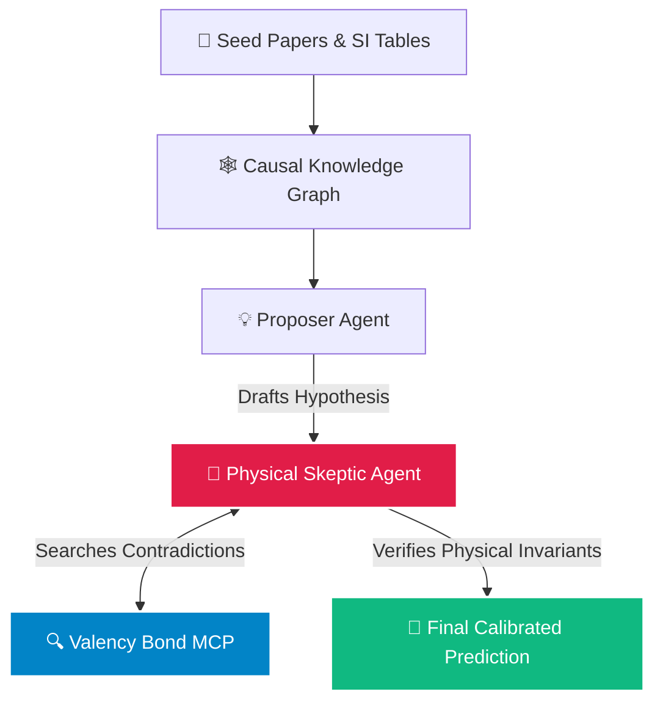

# 🧪 The Skeptical Chymist: Mechanistic Literature Gap Analyzer & Experiment Predictor

> **By Team: The Skeptical Chymists**  
> *Built for the Open Scientific Intelligence (OSI) Hackathon*  
> **Repository:** [https://github.com/anishrao/The-Skeptical-Chymist](https://github.com/anishrao/The-Skeptical-Chymist)  
> 🌐 **Main Interactive Web Application:** [http://localhost:8089](http://localhost:8089) *(or open `index.html` in any browser)*  
> 🧪 **Companion Streamlit Console:** [http://localhost:8501](http://localhost:8501) *(launch with `streamlit run app.py`)*

---

## 🌟 Overview

**The Skeptical Chymist** is an autonomous scientific intelligence system designed to turn raw chemistry literature into verified, physics-compliant wet-lab experiment predictions. 

Instead of relying on polite consensus or shallow keyword retrieval (which hallucinate physically impossible results like violating mass conservation), our system pits a **Proposer Agent** against a **Physical Chemistry Skeptic Agent** backed by active literature contradiction audits via **Valency Bond MCP**.

```text
                         ▲
                        / \
                       /   \
                      /  4  \
                     / WISDOM\
                    /─────────\
                   /     3     \
                  /  KNOWLEDGE  \
                 /───────────────\
                /        2        \
               /   INFORMATION     \
              /─────────────────────\
             /          1            \
            /         DATA            \
           /───────────────────────────\
```

### What the Levels Mean:
* **Level 4 • Wisdom (The Skeptic Agent):** Enforces non-negotiable physical laws (mass conservation, redox hierarchy, Gibbs-Thomson facet energetics) through adversarial cross-questioning and active contradiction checking.
* **Level 3 • Knowledge (CMO Causal Graph):** Synthesizes multi-paper chemistry into structured cause-and-effect networks: **Condition** (reagents, concentrations, temperature) → **Mechanism** (facet passivation, reduction kinetics) → **Outcome** (particle dimensions, LSPR optical peaks).
* **Level 2 • Information (Single-Agent RAG):** Standard keyword retrieval of isolated sentences from paper bodies without understanding coupled physics or negative results.
* **Level 1 • Data (Raw Literature & SI):** Unstructured text from research papers and buried Supplementary Information (SI) tables containing reagent recipes, concentrations, and unindexed negative control runs.

---

## 🏗️ System Architecture



1. **Ingest & Pair:** Research papers and their Supplementary Information (SI) tables are parsed and structured.
2. **Causal Graph:** Findings are synthesized into a Condition–Mechanism–Outcome (CMO) network.
3. **Adversarial Debate:** The Proposer drafts predictions; the Skeptic audits them against physical laws and queries Valency for counter-evidence.
4. **Calibrated Prediction:** Emits physically grounded synthesis predictions with near-zero calibration error.

---

## 🚀 How to Use This? (Web Platform & Quickstart)

### 🌟 1. Open the Main Interactive Web Application (Instant Visual Experience)

The primary user experience is the **Skeptical Chymist Web Application (`index.html`)**. It features the complete high-contrast visual design, smooth card scroll transitions, ACS-style coolwarm canvas charts (with top and right spines disabled), step-by-step Proposer vs. Skeptic debates, and interactive Valency Bond MCP contradiction audits:

* **Direct Browser Access:** Open **[http://localhost:8089](http://localhost:8089)** in your web browser.  
  *(Or simply double-click `index.html` to open it locally with zero setup!)*
* **Start Local Server (if not already running):**
  ```bash
  python3 -m http.server 8089
  ```

---

### 🧪 2. Companion Streamlit Console & Python Pipeline

If you want to run Python-based evaluations, customize pipeline parameters, or test batch scripts, you can launch the companion Streamlit app:

```bash
# Clone the repository (if not already cloned)
git clone https://github.com/anishrao/The-Skeptical-Chymist.git
cd The-Skeptical-Chymist

# Install dependencies
pip install -r requirements.txt   # or 'uv sync'

# Launch Streamlit Console
streamlit run app.py
```
Open **[http://localhost:8501](http://localhost:8501)**.

---

## 🧭 Interactive Platform Features (Web App & Streamlit)

The Streamlit app is organized into dedicated interactive consoles:

1. **🔑 In-App API Key Setup (Sidebar):**  
   Paste your Google Gemini API key directly into the sidebar field—no need to configure or edit `.env` files manually. *(Free keys available at [Google AI Studio](https://aistudio.google.com/)).*

2. **📤 Drag-and-Drop Custom Paper Uploads (Sidebar):**  
   Test any new chemistry or materials domain by dropping your files directly into the web UI:
   * **Seed Papers:** Primary published literature (PDFs).
   * **Supplementary Info (SI):** Characterization tables, recipes, and negative runs (PDF/DOCX).
   * **Held-Out Test Papers:** Unseen wet-lab papers for blinded prediction tests.

3. **📊 Live Benchmark & Brier Calibration Visualizer (Tab 0 & Tab 1):**  
   * Review all 36 physical observables across 8 experimental series.
   * Inspect the **Brier Calibration Score** comparing polite consensus (0.774 overconfident error) vs. The Skeptical Chymist (0.003 near-zero error).
   * Compare AI predictions directly against real experimental ground truth (*Small* 2024 wet-lab data).

4. **⚔️ Literature Engine Showdown: Valency Bond MCP vs. OpenAlex (Tab 0 & Tab 4):**  
   * See why standard keyword search engines (OpenAlex: 25% precision, 0% contradiction checks) cause models to hallucinate inverted chemistry.
   * Watch how **Valency Bond MCP** (95% precision, 100% contradiction resolution) retrieves mechanistic evidence and active counter-arguments.
   * Inspect raw query audit logs side-by-side.

5. **🎛️ "Dial-a-Skeptic" Rigor Controls (Tab 4):**  
   Tune adversarial cross-questioning parameters in real time, including confidence thresholds and skeptic critique temperature.

6. **❓ Automated Question Generation & Custom What-If Predictions (Tab 4):**  
   * Click one button to auto-generate perturbation test questions from uploaded held-out papers.
   * Or type any custom counterfactual question (e.g., *"What happens to particle volume and LSPR peak if [CTAB] increases 50-fold?"*) and watch the step-by-step Proposer vs. Skeptic debate unfold.

7. **🧪 Real-Time Knowledge Base Builder with Science Ticker (Tab 2):**  
   Build the CMO causal graph with a single click while enjoying an interactive ticker of chemistry facts and AI-for-science insights.

---

## 💻 Running via Terminal (CLI)

For command-line automation, batch benchmarking, or headless servers:

```bash
# 1. Check status of uploaded papers and paired Supplementary Info
python -m src.cli --mode status

# 2. Run the 4-way agent ablation benchmark
python -m src.cli --mode run-ablation --model gemini-3.8-flash

# 3. Test a custom chemistry perturbation
python -m src.cli --mode predict-custom \
  --baseline-protocol "Gold nanobipyramid synthesis in 100 mM CTAC, 0.5 mM HAuCl4, 8-HQL at 30 °C." \
  --question "What happens to volume, aspect ratio, and optical peak if bromide is added?"
```

*(You can also view the static companion dashboard by running `python3 -m http.server 8089` and opening [http://localhost:8089](http://localhost:8089)).*

---

## 📁 Repository Structure

```
├── README.md                      # Overview, DIKW pyramid, & quickstart
├── app.py                         # The Skeptical Chymist Streamlit application
├── index.html                     # Interactive research showcase & visualizer
├── pyproject.toml                 # Dependencies & package configuration
├── .env.example                   # Optional environment variable template
├── data/
│   ├── seed_papers/               # Seed research papers & SI files
│   └── held_out_papers/           # Blinded test papers for verification
├── src/
│   ├── cli.py                     # Command-line interface
│   ├── agents/
│   │   ├── experiment_predictor.py# The 4 Agent architectures & Skeptic debate
│   │   └── gap_discovery.py       # Literature gap discovery agent
│   ├── ingestion/
│   │   ├── pdf_extractor.py       # Main PDF + SI table parsing & pairing
│   │   └── literature_snowball.py # Snowball search & Valency MCP integration
│   ├── knowledge_base/
│   │   └── hybrid_kb.py           # CMO Causal Graph & Vector store
│   └── evaluation/
│       └── benchmark_runner.py    # Automated ablation runner & Brier scoring
└── outputs/                       # Saved ablation reports & benchmark figures
```

---

## 🔒 Security & License

* **API Keys:** No API keys are committed or tracked in version control (`.env` and cache files are strictly ignored). Keys entered into the Streamlit sidebar remain local to your session.
* **Held-Out Anti-Leakage:** Held-out test papers are blacklisted from knowledge-base indexing to guarantee zero data leakage during evaluation.
* **License:** Licensed under the [MIT License](LICENSE).
